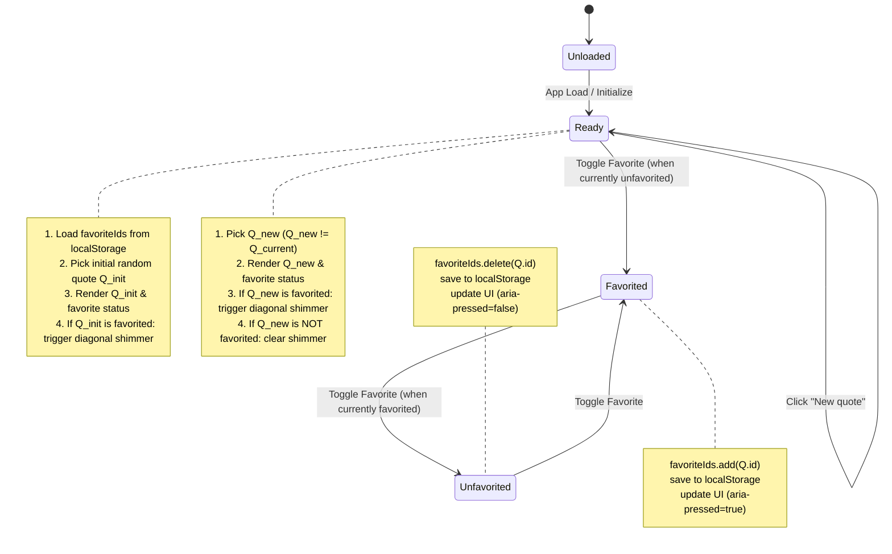

# Data Model: Quote of the Day

**Feature**: Quote of the Day (`001-quote-of-the-day`)  
**Date**: 2026-10-12  
**Status**: Completed  

---

## 1. Entities

### Quote
Represents a discrete quote item contained within the built-in application catalog.

| Field | Type | Required | Description | Constraints |
| :--- | :--- | :--- | :--- | :--- |
| `id` | `string` | Yes | Unique identifier for the quote | Non-empty, alphanumeric / slug format (e.g., `"q-01"`) |
| `text` | `string` | Yes | The textual content of the quotation | Non-empty, trimmed string |
| `author` | `string` | Yes | The creator or speaker of the quotation | Non-empty; defaults to `"Unknown"` if uncredited |

#### Validation Rules
- `id` MUST be unique across all quotes in the catalog.
- `text` MUST NOT be empty or whitespace-only.
- `author` MUST NOT be empty (if empty or unspecified, assign `"Unknown"`).

---

### FavoriteStore
Represents the local client-side persistence model for user favorites.

| Field | Type | Required | Description | Constraints |
| :--- | :--- | :--- | :--- | :--- |
| `favoriteIds` | `Set<string>` / `Array<string>` | Yes | Collection of unique quote IDs marked as favorites | Contains valid string IDs matching quotes |
| `storageKey` | `string` | Yes | The key used for `localStorage` persistence | Const: `"qotd_favorites_v1"` |

#### Serialization Schema
Stored in `localStorage` as a serialized JSON array:
```json
["q-01", "q-04", "q-12"]
```

#### Validation & Fallback Rules
- Deserialization MUST safely parse JSON. If JSON is invalid or corrupted, the store resets to an empty set (`[]`) without throwing.
- Values MUST be strings.
- If `localStorage` access is denied (security exception) or quota is exceeded, the store seamlessly uses an in-memory `Set<string>` for the session.

---

## 2. State Lifecycle & Transitions



---

## 3. Data Flow

1. **Initialization**:
   - `storage.loadFavorites()` retrieves stored array of IDs from `localStorage['qotd_favorites_v1']`.
   - `quoteService.getRandomQuote(null)` returns $Q_1$.
   - `ui.renderQuote(Q_1, storage.isFavorite(Q_1.id))`.
   - If `storage.isFavorite(Q_1.id)` is true: `ui.triggerShimmer()`.
2. **Next Quote**:
   - User clicks "New quote".
   - `quoteService.getRandomQuote(currentQuote.id)` returns $Q_2$ ($Q_2 \neq Q_1$).
   - `ui.renderQuote(Q_2, storage.isFavorite(Q_2.id))`.
   - If `storage.isFavorite(Q_2.id)` is true: `ui.triggerShimmer()`; otherwise `ui.clearShimmer()`.
3. **Toggle Favorite**:
   - User clicks favorite button for $Q_2$.
   - `storage.toggleFavorite(Q_2.id)` toggles membership and serializes to `localStorage`.
   - `ui.updateFavoriteButton(storage.isFavorite(Q_2.id))`.
